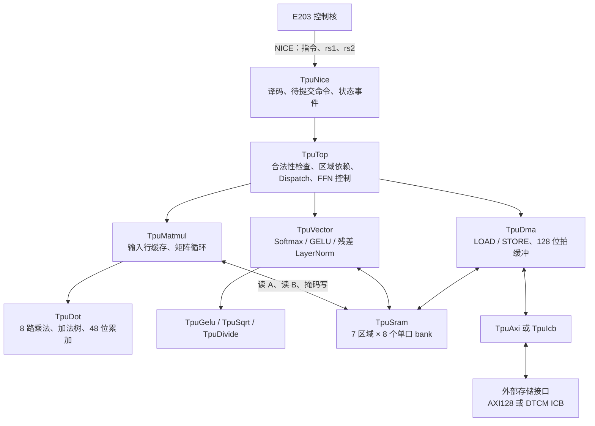

# 2026TpuSoc RTL 架构梳理

整理日期：2026-11-09。分析对象为当前工作区 `2026TpuSoc/Rtl/` 的全部 19 个 SystemVerilog 文件，并核对 `Backend/` 集成封装、E203 核接口及 `Sw/Encoder.c` 的实际调用。包含工作区尚未提交的 FF1 行命令与 ICB 接口，不采用同级 `2026TpuSoc_frontend_20261109/` 快照。

本文描述源码实际结构和执行规则；历史文档、测试结果及综合报告仅作为延伸阅读。本次为静态代码梳理，没有重新执行功能仿真、综合或物理实现，文中的时钟目标不代表本次验证结论。

## 1. 总体定位

该设计是 **E203 软件控制的 KWT 编码器定点加速器**。CPU 负责参数装载、算子顺序和层间调度；TPU 负责一个算子内部的行、列、归约循环。硬件处理的典型输入为 `99×64`，前馈维度为 `64→256→64`。

计算硬件主要由一套八路 16×16 乘法点积流水线、矩阵控制器、向量控制器、112 KiB 私有 SRAM 和 DMA 构成。矩阵与向量任务串行使用计算入口；一个计算任务和一个 DMA 任务在依赖允许时可以重叠。没有指令队列、通用张量尺寸配置或自动执行十二层网络的硬件总控，十二层通过软件重复调用同一套硬件完成。

加速范围覆盖 Q/K/V 投影、缩放注意力、Softmax、输出投影、残差加 LayerNorm、FFN 与 GELU。音频前处理、输入投影和最终分类头不在这组 TPU RTL 内。



图中的 SRAM 连接表示逻辑通路，实际端口仲裁在 `TpuTop`；两个逻辑读口不等于每个 bank 都是双口存储器。

## 2. 文件与模块职责

以下链接均相对本文位置。

| 文件 | 主要职责 | 关键实现 |
|---|---|---|
| [TpuPkg.sv](../Rtl/TpuPkg.sv) | 全局布局和数值函数 | Regions、SlotBase、SlotSize、SlotRegions、RoundShift、Saturate |
| [TpuTop.sv](../Rtl/TpuTop.sv) | 加速器核心顶层 | 命令检查、物理区域 scoreboard、一级 Dispatch、计算/DMA 仲裁、融合 FFN 状态机 |
| [TpuNice.sv](../Rtl/TpuNice.sv) | CPU 命令接口 | custom3 译码、一个 Pending 请求、响应与完成/错误事件 |
| [TpuMatmul.sv](../Rtl/TpuMatmul.sv) | 矩阵执行控制 | 行缓存、偏置预取、地址生成、点积调度、舍入和单元素写回 |
| [TpuDot.sv](../Rtl/TpuDot.sv) | 点积运算 | 8 个 signed16 乘法、分级加法树、48 位累加 |
| [TpuVector.sv](../Rtl/TpuVector.sv) | 向量算子控制 | 行装载、归约、指数插值、残差 LayerNorm、GELU 发射与写回 |
| [TpuGelu.sv](../Rtl/TpuGelu.sv) | GELU 流水线 | 七级寄存、单通道、每拍可接收一个元素 |
| [TpuSqrt.sv](../Rtl/TpuSqrt.sv) | 整数平方根 | 40 位被开方数、20 位向下取整结果，20 轮迭代 |
| [TpuDivide.sv](../Rtl/TpuDivide.sv) | 无符号除法 | 48 位恢复除法，48 轮迭代；Softmax 与 LayerNorm 复用 |
| [TpuLut.sv](../Rtl/TpuLut.sv) | 数值查表包 | ExpTable、GeluTable，由模型工具生成 |
| [TpuRowBuffer.sv](../Rtl/TpuRowBuffer.sv) | 小型行缓冲 | 8 bank，8 元素并行写、单元素组合读，最多 256 元素，位宽可配置 |
| [TpuSram.sv](../Rtl/TpuSram.sv) | 主片上存储 | 固定读流水、区域选择、8 lane 写掩码、单口冲突断言 |
| [TpuDma.sv](../Rtl/TpuDma.sv) | 私有 SRAM 搬运 | 固定长度 128 位线性传输、单拍缓冲、错误保持 |
| [TpuAxi.sv](../Rtl/TpuAxi.sv) | AXI128 适配 | 单 outstanding、INCR、4 KiB 边界拆分、最多 256 拍 |
| [TpuIcb.sv](../Rtl/TpuIcb.sv) | 平台 DTCM 适配 | 128 位拍拆为四个 32 位 ICB 请求，逐笔等待响应 |
| [TpuNiceAxi.sv](../Rtl/TpuNiceAxi.sv) | 独立加速器封装 | TpuNice + TpuAxi，不包含 CPU |
| [E203Tpu.sv](../Rtl/E203Tpu.sv) | 双时钟 CPU 集成 | 真实 e203_core、NICE 请求/响应 CDC、TPU、AXI |
| [TpuCdc.sv](../Rtl/TpuCdc.sv) | 跨时钟邮箱 | 单条目 bundled-data，toggle 请求/确认、双级同步 |
| [TpuResetSync.sv](../Rtl/TpuResetSync.sv) | 域复位 | 异步拉低、两级同步释放 |

## 3. 系统集成的三种路径

### 3.1 双时钟 CPU + AXI：`Rtl/E203Tpu.sv`

```text
e203_core [CpuClock]
  └─ NICE → 请求邮箱 96 bit → TpuNice [Clock] → TpuTop
           ← 响应邮箱 33 bit ←                └─ DMA → TpuAxi → AXI128
```

请求携带 `{Instruction, Rs1, Rs2}`，响应携带 `{Error, Data}`。CPU 侧 `CpuTransactionBusy` 限制一条未完成的 NICE 交互；它限制的是命令响应往返，不要求已提交的计算任务先完成。CPU 与 TPU 各自同步释放复位，共享复位断言。

顶层直接例化 `e203_core`，对外暴露 IFU 取指、LSU 访问 ITCM/DTCM、系统 ICB 和 TPU AXI128。复位入口为 `0x80000000`，DTCM 区域基址为 `0x90000000`。取指响应为 64 位，CPU 数据接口为 32 位；该封装的 TCM 地址端口为 16 位。外部中断、调试和若干外设接口被固定为不启用状态。

E203 上游核心包含 IFU、EXU、LSU、BIU；EXU 内部完成译码、派发、寄存器访问、运算、提交与写回。TPU 通过 NICE 扩展接入，不需要 CPU 为每次乘加发指令。此封装将 NICE memory ICB 请求关闭，DMA 使用独立 AXI 通路。

### 3.2 单时钟 CPU + AXI：`Backend/E203TpuBackend.sv`

[后端顶层](../Backend/E203TpuBackend.sv)与双时钟封装使用相同的 `TpuNice → TpuTop → DMA → TpuAxi` 核心结构，但 CPU、TPU、AXI 共用一个 `Clock`，NICE 直接相连，没有 CDC 邮箱，使用公共复位同步释放器。

该路径目标时钟为 150 MHz；源码清单为 [Backend/Files.f](../Backend/Files.f)。它仍保留外部 TCM、系统 ICB 和 AXI 接口，不在封装内实现完整 DDR 控制器。

### 3.3 平台 NICE memory ICB + 共享 DTCM

[Backend/e203_subsys_nice_core.sv](../Backend/e203_subsys_nice_core.sv)替换平台原有的同名示例 NICE 模块：

```text
平台 CPU ── NICE 命令 ── TpuNice → TpuTop → 私有 SRAM
                         └─ DMA → TpuIcb → NICE memory ICB → 原 LSU → DTCM
外部加载器 ───────────────────────────────────────────────→ DTCM
```

这里“共享 SRAM”指 CPU、外部加载器与 TPU 搬运共同访问平台 DTCM，**112 KiB TPU 私有 SRAM 仍然存在**。模块设置 `nice_mem_holdup=0`，仲裁由原 LSU 路径承担。

`TpuIcb` 每次只允许一个 32 位请求在途；一个 128 位拍按低字到高字拆成四次访问，地址逐次增加 4 字节。合法外部范围为 `[0x90000000, 0x90040000)`，即 256 KiB DTCM，且整笔请求必须在范围内、非零长度、16 字节对齐。越界请求不发到 ICB，仍按声明长度接收或交付数据并报告错误。STORE 直到最后一个字写响应返回才完成。

因此，ICB 桥所需的 256 KiB 平台配置，不能与双时钟封装及上游本地 `config.v` 中的 16 位 TCM 地址配置混为一谈。完整平台取决于对应构建清单和 TCM 配置，详见 [SharedSram.md](SharedSram.md)。

## 4. 命令接口与调度

### 4.1 NICE 编码

`TpuNice` 接受 opcode=`0x7b`、funct3=`111`、funct7 为 0～3 的指令。

| funct7 | 命令 | rs1 | rs2 |
|---:|---|---|---|
| 0 | LOAD | 外部字节地址 | 搬运规格和目标槽位 |
| 1 | EXEC | 算子及槽位等元数据 | 模板 10 使用完整 32 位行号；其他模板不使用该值作为行号 |
| 2 | STORE | 外部字节地址 | 搬运规格和源槽位 |
| 3 | STATUS | 事件清除掩码 | 不使用 |

EXEC 元数据字段：

| 位段 | 含义 |
|---|---|
| `[3:0]` | ShapeId |
| `[6:4]` | SourceSlot |
| `[9:7]` | AuxiliarySlot：权重、第二操作数或残差 |
| `[12:10]` | ParameterSlot：LayerNorm 参数或融合 FF2 参数 |
| `[15:13]` | DestinationSlot |
| `[16]` | BiasEnable |
| `[21:17]` | 第一参数小数位 |
| `[26:22]` | 第二参数小数位，供融合 FF2 使用 |

LOAD/STORE 的元数据中 `[3:0]` 为搬运规格，`[6:4]` 为槽位。小数位字段一般允许 1～15，0 兼容解释为 10；大于 15 的 EXEC 被拒绝。模板 10 明确禁止第一小数位为 0。

### 4.2 接收、执行和完成分离

```text
NICE 请求握手
 → TpuNice 保存 Pending 请求
 → 等待 TpuTop.CommandReady
 → 合法命令进入一级 Dispatch；NICE 返回命令响应
 → 下一拍启动矩阵 / 向量 / DMA / 融合控制器
 → 执行完成产生事件，CPU 通过 STATUS 查询
```

命令响应不表示计算结束。编码合法但任务参数非法时，`TpuTop` 不执行该任务，通过命令错误事件反馈；非法 NICE 编码则通过 `NiceResponseError` 反馈。Pending 或未消费响应存在时，`TpuNice` 不再接受下一条请求，因此也不能绕过待提交请求去查询 STATUS。

STATUS bit 0/1 分别为计算忙、DMA 忙；bit 2/3 为计算完成、DMA 完成；bit 4/5 为命令错误、DMA 错误。bit 2～5 为保持事件，rs1 对应位写一清除，返回清除前状态；同周期新事件优先于清除。`NiceActive` 包含请求、Pending、响应和运行任务，但本身不实现时钟门控。

### 4.3 物理区域 scoreboard

`TpuTop` 为计算和 DMA 分别记录读、写区域掩码。新的写与在途读/写冲突、新的读与在途写冲突都会等待。读读可共存；逻辑槽位即使编号不同，只要映射到同一区域，也按物理依赖检查。

资源方面同一时间最多一个计算任务和一个 DMA 任务，矩阵与向量不会作为两个独立计算任务并行。Dispatch 只有一级寄存，不是多条命令队列，也不做乱序调度。

DMA 与计算共享 SRAM 读 A 和写端口，计算优先。DMA 读还检查计算读 B 使用的区域；DMA 写必须等待计算没有发出写请求。因而“允许重叠”不代表计算与 DMA 始终能同时满带宽运行。

## 5. 片上存储架构

### 5.1 主 SRAM 的组织

默认 `Regions=7`；每区域包含 8 个 `1024×16 bit` 单口 bank，组合成 `1024×128 bit`，每区域 16 KiB，总计 **56 个 bank、112 KiB**。

主 SRAM 地址为 128 位字地址，宽 14 位：`[13:10]` 选择区域，`[9:0]` 为区域内行号。槽位基址和容量则以 **16 位元素** 为单位；元素地址右移 3 位后进入 SRAM，外部 DMA 地址另以字节为单位。

读通路固定三拍：请求寄存 → bank 读取 → 输出选择/寄存。计算控制器按固定时延安排数据标签，不通过每笔读响应 valid/ready 等待。写掩码为 8 位，每位控制一个 16 位 lane；单元素结果只写对应 bank，无须对整个 128 位字做读改写。

两个读口可以访问不同区域，但同一区域同周期只能执行一个地址操作。RTL 用断言禁止同区域 A/B 双读、A 读与写、B 读与写碰撞。SRAM 数组不复位清零，所有将被消费的数据必须先由 LOAD 或已完成的 EXEC 建立。

### 5.2 默认紧凑槽位

| 槽位 | 元素基址 | 元素容量 | 字节容量 | 常见用途 | 覆盖区域 |
|---:|---:|---:|---:|---|---|
| 0 | 0 | 8192 | 16 KiB | 输入、残差、Norm 和最终输出 | 0 |
| 1 | 8192 | 8192 | 16 KiB | Q、注意力/FF2 输出、独立 FF1 单行 | 1 |
| 2 | 16384 | 8192 | 16 KiB | K | 2 |
| 3 | 24576 | 8192 | 16 KiB | 转置 V | 3 |
| 4 | 32768 | 16384 | 32 KiB | 注意力分数与概率 | 4、5 |
| 5 | 8192 | 8192 | 16 KiB | 与槽位 1 完全别名 | 1 |
| 6 | 16384 | 16640 | 32.5 KiB | FF1 权重和偏置 | 2、3、4 |
| 7 | 33024 | 16448 | 32.125 KiB | 普通参数、融合 FF2 参数 | 4、5、6 |

槽位不是八块独立 SRAM，表内容量不能相加。槽位 6 的末尾与槽位 7 的开头在元素地址上连续且不重叠，但都占用区域 4，scoreboard 会保守地将相关写入判为冲突。参数复用 K/V/分数占过的物理空间，软件必须保证旧数据生命周期已经结束。

### 5.3 局部缓存及存储实现开关

矩阵输入行缓存为 `32×128 bit`，即 512 B；偏置缓冲使用默认 16 位 `TpuRowBuffer`，最多 256 元素。向量行缓冲使用 17 位元素以保留残差和，另有 `128×21 bit` 指数暂存和 gamma/beta 寄存器。这些缓存及 LUT 均在主 SRAM 之外，需要另计实现资源。

| 配置 | 源码行为 |
|---|---|
| 默认 | TpuSram 使用 `ram_style="block"` 数组，供 FPGA 推导 |
| `TPU_SRAM_MODEL` | 每个 lane 例化 `kwt_sp_memory_model` |
| 工艺宏包装 | [Server/Backend/SpFoundry.sv](../Server/Backend/SpFoundry.sv)以同名模块替换仿真模型，内部例化 RAMSP1024X16，结合相应源清单使用 |
| `TPU_LEGACY_STORAGE` | Regions=16，主 SRAM 为 256 KiB，槽位 5/6/7 改为独立的旧布局，用于整矩阵 FFN 路径 |

仅打开宏不能保证绑定正确，实际 bank 实现由编译宏与参与编译的包装源文件共同决定。

## 6. 矩阵计算通路

`TpuMatmul` 每行先取偏置及输入数据，再遍历所有输出列。输入行装入局部缓存后，在列之间复用；权重按输出通道优先的 `N×K` 布局顺序读取，因此不是二维脉动阵列。

```text
主 SRAM 读 A → 输入行缓存 ──────────────┐
主 SRAM 读 B → 当前输出列权重 → TpuDot │
                  8 路乘法 → 4 对求和 → 2 组求和 → 总和 → 48 位累加
                                                     ↓
偏置行缓冲 ─────────────────→ 舍入移位 → 加偏置 → signed16 饱和
                                                     ↓
                                         主 SRAM 单 lane 掩码写
```

每个有效输入拍处理 8 对 signed16 元素；K=64/256/99 分别需要 8/32/13 个点积输入拍。K=99 的最后一拍仅使用前 3 个 lane，后 5 个强制屏蔽。`InputFirst` 清累加起点，`InputLast` 产生点积输出，valid/first/last 随数据流水传递。

每个输出结果是一个标量；矩阵层面每拍八次乘法不等于每拍八个输出。行装载、排空和写回还会增加开销。行切换等待本行最后结果写出，所以模板 0 可以支持同布局输入输出原地更新。

| EXEC 编号 | 运算与布局 | 默认紧凑布局的关键限制 |
|---:|---|---|
| 0 | `99×64 · 64×64 → 99×64`，普通线性 | 输出不得覆盖权重区域；允许与输入同基址 |
| 1 | V 投影，输出 `64×104`，每行前 99 项有效 | 转置写回，输入输出不可重叠 |
| 2 | FF1，`99×64 → 99×256` | 完整输出 25344 元素，默认任何槽位均放不下 |
| 3 | FF2，`99×256 → 99×64` | 完整输入 25344 元素，默认槽位放不下 |
| 4 | `QKᵀ/8`，输出 `99×104`，前 99 列有效 | 禁止偏置 |
| 5 | `99×104` 概率乘转置 V，输出 `99×64` | 禁止偏置，忽略 K 维的五项 padding |
| 10 | FF1 单行，`1×64 → 1×256` | 固定 Src=0、Aux=6、Param=0、Dst=1、Bias=1；rs2 行号 0～98 |

模板 10 在顶层以 ShapeId 低三位映射为矩阵内部 FF1 模式，并开启 SingleRowEnable。输入偏移为 `row×64`，结果从槽位 1 起始处写 256 元素。行号使用完整 32 位比较后才缩窄，非法高位不会被截断为合法行号。

## 7. 向量计算通路

`TpuVector` 的内部模式 0/1/2 对应外部 EXEC 6/7/8。三个算子共用行装载与结果写回框架；除 GELU 外，主要由多周期状态机逐元素处理。

| 外部编号 | 算子 | 行宽及存储步长 | 执行过程 |
|---:|---|---|---|
| 6 | Softmax | 宽 99、步长 104，共 99 行 | 取行最大值 → 减最大值 → exp 查表插值 → 指数求和 → 共享除法器求倒数 → 概率写回 |
| 7 | GELU | 宽 256、步长 256，共 99 行 | 装载行缓存 → 连续发射 256 元素 → 七级流水 → 排空后切行 |
| 8 | 残差 + LayerNorm | 宽 64、步长 64，共 99 行 | 两路读数并保留 17 位残差和 → 均值/方差 → 平方根/倒数 → gamma、beta 仿射 → 饱和写回 |

Softmax 先缓存每个指数值，再用共享倒数产生概率，输出可以原地覆盖分数。GELU 查正半轴表并利用 `GELU(-x)=GELU(x)-x` 恢复负半轴，每拍一个元素，索引随流水传递。独立整矩阵模板 7 的 25344 元素同样超过紧凑槽位容量；融合 FFN 内部只执行单行 GELU。

LayerNorm 以 gamma64 后接 beta64 的形式存参数，分时从读 A 取参数；输入和残差不能占同一物理区域，输出不能覆盖参数区域。行数据先进入缓冲，因此计算结果可以覆盖已读入的输入或残差。开方器迭代 20 轮，除法器迭代 48 轮，启动/等待等控制周期另计。

## 8. 融合 FFN 与独立 FF1 的区别

### 8.1 模板 9：硬件逐行融合

`TpuTop` 内的 `FusedState` 按以下顺序执行 99 行：

```text
FirstStart → FirstWait → GeluStart → GeluWait → SecondStart → SecondWait
   FF1                     GELU                      FF2
                           ↑                           │
                           └──── 下一行重新从 FF1 开始 ┘
```

固定输入槽位 0、FF1 参数槽位 6、FF2 参数槽位 7，输出槽位 1 或别名 5，且必须开启偏置。对每个 token：

1. FF1 读取槽位 0 中本行 64 元素，把 256 元素结果写到槽位 0 的元素 `7168..7423`。
2. GELU 原地处理这 256 元素。
3. FF2 读取该中间行，将 64 元素输出写入目标槽位的本行。
4. 下一行复用同一块 512 B 中间空间；第 98 行完成后上报一次计算完成。

有效输入仅占槽位 0 的 `0..6335`，中间行不会覆盖它。两组参数全层驻留，矩阵单元与向量单元轮流工作；没有第二套 MAC，也没有省略中间舍入/饱和。scoreboard 将源槽位同时记为读、写，以保护这块内部暂存。

### 8.2 模板 10：软件逐行导出 FF1

独立 FF1 需要完整 `99×256` 外部结果，但主 SRAM 无须同时保存所有行。[Sw/Encoder.c](../Sw/Encoder.c)中的 `TpuRunFf1` 先装载输入和 FF1 参数，然后循环执行 99 次：

```text
EXEC 10(row) → 等计算完成 → STORE 规格 9，共 256 元素 → 等 DMA 完成
```

每行 512 B，STORE 外部地址为 `OutputAddress + row×512`。它不执行 GELU/FF2，也不是模板 2 的完整矩阵常驻执行方式。

## 9. DMA 与外部接口

### 9.1 传输规格

LOAD/STORE 共享 ShapeId 字段，但规格编号的含义与 EXEC 编号独立。每拍 128 位，包含 8 个 16 位元素，拍数为元素数除以 8。

| 规格 | 元素数 | 128 位拍数 | 常见内容 |
|---:|---:|---:|---|
| 0 | 6336 | 792 | 99×64 激活 |
| 1 | 4096 | 512 | 64×64 无偏置权重 |
| 2 | 4160 | 520 | 64×64 权重 + 64 偏置 |
| 3 | 16640 | 2080 | FF1 权重 + 256 偏置 |
| 4 | 16448 | 2056 | FF2 权重 + 64 偏置 |
| 5 | 128 | 16 | LayerNorm gamma + beta |
| 6 | 10296 | 1287 | 99×104 分数或概率 |
| 7 | 25344 | 3168 | 99×256 激活，默认紧凑布局容量不足 |
| 8 | 6656 | 832 | 64×104 转置 V |
| 9 | 256 | 32 | 独立 FF1 一行 |

地址必须 16 字节对齐，超槽位容量的请求在顶层拒绝。LOAD 接收一拍到 Buffer，再等待 SRAM 写授权；STORE 发出 SRAM 读后等待固定延迟，把数据存入 Buffer，再等待外部 ready，最终等待写响应。单拍缓冲解决反压问题，不是多块 ping-pong 缓冲。

LOAD 遇到错误或 Last 不匹配时保持 Error，但仍按预定拍数接收后完成；它不会自动回滚已写入 SRAM 的数据。STORE 在收到最终写响应后报告完成。没有通用事务超时机制，外部适配器必须交付完整协议响应；复位时还需清除或隔离旧外部事务。

### 9.2 AXI 路径

`TpuAxi` 实现固定 16 B/beat、INCR、全字节写的 AXI 子集，无 ID 重排；整笔只允许一个方向的事务在执行。按 4 KiB 边界和 256 拍上限拆分，AXI `LEN=burst_beats-1`、`SIZE=4`、`BURST=1`、`WSTRB=0xffff`。

读路径把各 burst 的 RLAST 检查与整笔 DMA 的 Last 分开处理；写路径逐 burst 等待 B 响应，汇总错误后给 DMA 一次最终完成响应。AXI 引脚之外的 DDR 控制器、PHY 和校准均不由这些模块实现。

## 10. 定点格式与运算边界

本文以“有符号位宽 + 小数位数”描述格式，避免 Q 格式整数位是否包含符号位的歧义。

| 数据 | 存储格式/运算规则 |
|---|---|
| 激活、线性偏置、LN beta | signed16，11 位小数 |
| 线性权重、LN gamma | signed16，由命令指定 1～15 位小数 |
| 注意力分数 | signed16，10 位小数；QK 点积统一右移 15 位，包含除 8 |
| Softmax 概率 | signed16，15 位小数，非负；精确 1 饱和为 32767 |
| 概率乘 V | 点积右移 15 位，恢复激活尺度 |
| 点积中间值 | signed32 乘积、分级扩位求和、signed48 累加 |
| 舍入/溢出 | 最近值、中点远离零；写回 signed16 时饱和 |

线性计算顺序是点积按权重小数位舍入，再加激活尺度偏置，最后饱和。Softmax 的 exp 表为 20 位小数，减最大值后的差在 `[0,16)` 内插值，超范围指数置零；各概率独立舍入，行和不保证严格等于 1。

LayerNorm 残差相加保留 17 位，中心化值保留到 15 位小数，平方和除 64 后加整数 1074，对应 epsilon 约 `1074/2^30`。整数平方根向下取整，除法器使用 `2^34` 作倒数分子，归一化结果恢复到 11 位小数后再做 gamma/beta 仿射。Softmax 倒数分子则为 `2^44`。

## 11. 单层和多层的数据流

下表依据当前 `TpuRunLayer`，省略每步前的参数 LOAD 和 STATUS 等待。

| 顺序 | 操作 | 槽位流向 |
|---:|---|---|
| 1 | Q 投影，模板 0 | 0 → 1，权重在 7 |
| 2 | K 投影，模板 0 | 0 → 2，权重在 7 |
| 3 | V 投影，模板 1 | 0 → 3，转置保存，权重在 7 |
| 4 | QKᵀ/8，模板 4 | 1、2 → 4 |
| 5 | Softmax，模板 6 | 4 → 4 |
| 6 | 概率乘 V，模板 5 | 4、3 → 5，实际位于槽位 1 |
| 7 | 输出投影，模板 0 | 5 → 1，同布局原地更新，参数在 7 |
| 8 | 残差 + Norm1，模板 8 | 1 + 0 → 0，gamma/beta 在 7 |
| 9 | 融合 FFN，模板 9 | 0 → 1，FF1 参数在 6，FF2 参数在 7 |
| 10 | 残差 + Norm2，模板 8 | 1 + 0 → 0，gamma/beta 在 7 |

输入和最终输出都在槽位 0，因而多层可以直接保留激活，只更换当前层参数。软件当前采取顺序等待方式；硬件允许的 DMA/计算重叠能力并不等于该软件已做预取调度。普通执行流不需要 STORE 每个中间张量，逐阶段校验时增加的 STORE 属于测试流量。

## 12. 阅读及验证入口

建议先读 `TpuPkg → TpuTop → TpuNice` 确定容量和命令边界，再读 `TpuMatmul/TpuDot`、`TpuVector`，最后根据集成目标选择 AXI 或 ICB 封装。完整 SoC 外设树位于上游 `e203_hbirdv2/rtl/e203/`，不能把直接例化 `e203_core` 的封装当作已连接全部外设的 SoC 顶层。

项目已有验证入口如下，仅列复现用途，本次未执行：

| 入口 | 主要覆盖 |
|---|---|
| `make lint` / `make arithmetic` | 核心接口静态检查、点积/除法/平方根 |
| `make nice` / `make ff1` | NICE 协议、命令约束和独立 FF1 |
| `make axi` / `make icb` | 两种外部适配器的握手及错误路径 |
| `make test` / `make official` | 合成输入、官方参数与分阶段数值检查 |
| `make cdc` / `make soc` | 异步邮箱、真实 E203 软件控制的多层执行 |
| `make sram-model` / `make legacy` | 单口 bank 模型、旧容量下的完整 FFN 模板 |
| `bash Server/Shared/Local.sh` | 平台 CPU/LSU/TCM 共享路径的本地回归 |

接口与数值细节可继续参考 [Implementation.md](Implementation.md)、独立 FF1 的 [Ff1.md](Ff1.md)、平台加载路径的 [SharedSram.md](SharedSram.md)。这些资料中部分章节早于当前 FF1/ICB 扩展；接口差异应以本次所读工作区 RTL 和对应构建清单为准。
