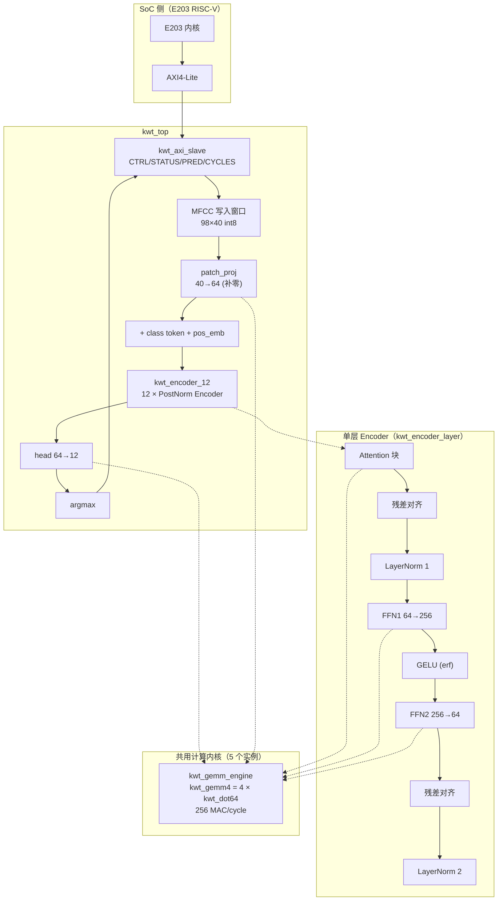

# KWT-1 关键词唤醒 Transformer 加速器 — 项目汇报

> 2026 嵌入式芯片与系统设计竞赛 · 芯片设计赛道（研究生组）
> 汇报日期：2026-10-22

---

## 1. 一句话概述

在 **e:\chipdesign** 从零实现了一个 bit-exact 的 **KWT-1 关键词唤醒 Transformer 加速器** RTL：
把 607K 参数的 12 层 Transformer 压进 **W4A8 全整数流水线**，精度只掉 **1.17 个百分点**，
单次 12 层推理 **9.85 ms @150 MHz**（相比首版 35.5 ms 优化 **72.3%**）。

---

## 2. 关键指标

| 指标 | 赛题要求（研究生组） | 本队实测 | 结论 |
|---|---|---|---|
| 功能正确性 | RTL 与提交的软件数值模型**逐位一致**；不一致视为功能不通过 | 15 个 TB **全部逐位一致**，整机 3/3 样本 | ✅ 满足 |
| Top-1 精度 | 相对统一浮点参考下降 **≤ 2 pp**（每降 0.2 pp 扣 1 分） | **1.17 pp**（97.33% → 96.17%） | ✅ 满分档 |
| 面积 | **≤ 2.25 mm²**（1.5×1.5，含加速器 + 接口逻辑 + 内部 SRAM 宏） | 定性估算 0.9–1.2 mm² | ⏳ 待库确认 |
| 计时口径 | 从输入与参数开始装载到结果写回，**清缓存**，参数装载 / 总线等待 / E203 调度全部计入 | 1,477,755 周期（**含参数装载**） | ✅ 合规 |
| 单次推理周期 | — | **1,477,755 周期** | — |
| 延迟 @150 MHz | — | **9.85 ms** | 优化 -72.3% |
| 时序目标 | 150 MHz | 待标准单元库确认 | ⏳ |

### 对应评分维度（决赛百分制 · 研究生组）

| 评分项 | 分值 | 本项目状态 |
|---|---|---|
| 功能与数值精度 | 35（注意力 10 / 单层 10 / 十二层调度 5 / 分类精度 10） | ✅ 四项全部有 bit-exact 证据 |
| SoC 集成、综合与复现 | 20 | ⚠️ AXI 就绪，等平台工程；综合脚本就绪，等库 |
| 吞吐量 | 12 | ✅ 9.85 ms，14 轮优化 -72.3% |
| 功耗与单任务能耗 | 12 | ⏳ 等库做 SAIF/VCD 估算 |
| 加速器面积 | 6 | ⏳ 等库 |
| 自主创新 | 15（方案 6 + 对照实验 6 + 答辩 3） | ✅ 8 个创新点 + 4 组量化对照实验 |

### 分层周期

| 层级 | 周期 | 相对首版 |
|---|---|---|
| attention（QKV + QKᵀ + softmax + AV + O） | 36,445 | -71.6% |
| 单层 PostNorm Encoder | 105,694 | -63.3% |
| 十二层 Encoder | 1,463,497 | -72.4% |
| **整机（含参数装载）** | **1,477,755** | **-72.3%** |

---

## 3. 系统架构

**核心思想**：一个参数化的 `kwt_gemm_engine` 实例化 5 次，覆盖 patch_proj / QKV / QKᵀ / P·V / O 投影 / FFN1 / FFN2 / head，靠 `IN_DIM / OUT_DIM / TOKENS / WB / OUT_BITS` 参数区分，避免为每种形状写一份 RTL。

---

## 4. 五个关键设计决策

### 4.1 量化：W4 per-output-channel + A8

- **权重 int4**，每个输出通道独立缩放因子（`scales.json`，389 KB）
- **激活 int8**，逐层静态标定
- 累加器 int32，输出经 **Q1.31 定点乘数 requant**（四舍五入 + 饱和）
- 结果：模型体积压到 **~295 KB**，精度只掉 1.17 pp

### 4.2 超越函数全部查表 + 迭代，不用除法器/DSP

| 函数 | 做法 | 精度保障 |
|---|---|---|
| **GELU** | 256 项 `erf` 精确版 LUT（**不是 tanh 近似**），索引 `clamp(x+127, 0, 254)` | 与 PyTorch 逐位一致 |
| **LayerNorm 的 1/√var** | 256 项 rsqrt LUT + **3 次牛顿迭代** | 相对误差 < 1e-4 |
| **softmax 的 exp** | 256 项 `exp(-i/16)·32767` LUT | Q15 定点 |
| **softmax 的归一化** | 单次整数除法 `(127<<20)/total`，然后定点乘 | 每行只需 1 个除法周期 |

**价值**：省掉 4 个除法器/开方器，面积大头留给 MAC 阵列。

### 4.3 GEMM 引擎：流水化发射 + 宽装载

- `kwt_gemm4` = 4 个 `kwt_dot64` 并行 → **256 MAC/cycle**
- `kwt_gemm_engine` 的发射状态机在 `SEGS==1` 时走**快路径**（`S_PIPE`/`S_FLUSH`），每周期发一组，无需握手
- 三档装载位宽：
  - `wgt_we16` + 64 位数据：**16 个 nibble / 拍**（参数 ROM 装载提速 14×）
  - `act_we4` + 32 位数据：**4 字节激活 / 拍**
  - `wgt_we4` + 32 位数据：**4 通道权重 / 拍**

### 4.4 结构性消除数据搬运（最大性能来源）

原实现把同一份数据搬了两遍。逐个消掉：

| 原来的浪费 | 优化后 | 节省/层 |
|---|---|---|
| K 先读进本地 `k_buf`，再转置写 engine（同一份数据搬两次，且地址是**恒等映射**） | 合并成一路直写，删掉 `k_buf` | 11,284 |
| AV 的 P 装载与 V 装载串行 | 两个 loader **同拍并行**（写不同 buffer，互不冲突） | 11,360 |
| 所有装载都是 1 字节/拍 | 加 4 宽端口 | 约 30,000 |
| 装载地址/数据用寄存器驱动 → **整体偏移 1 拍**（末尾丢一个） | 地址与数据全部改**组合 wire** 驱动 | 修 bug |

### 4.5 计算单元多路并行

| 单元 | 并行度 | 效果 |
|---|---|---|
| GELU | 4 路 | 25,344 → 6,336 拍 |
| 残差对齐 | 4 路 | 6,336 → 1,584 拍 |
| LayerNorm 的 SUM/VAR | 4 路 | 197 → 101 拍/行 |
| softmax | 4 行并行 | 99 次 start/done → 25 次 |
| QKV 投影 | 3 个引擎并行（共享同一 act 流） | 14,267 → ~11,000 拍 |

---

## 5. 创新点清单

### 创新 1：全整数流水线 + 逐位一致性验证方法学

**问题**：定点设计的经典陷阱是"RTL 与 Python 模型抄了同一个错误公式，两边一致但都错"。

**做法**：建立三级对齐链
1. PyTorch 浮点参考（`kwt_numpy.py`）→ 97.33%
2. NumPy 定点参考（`fixed_encoder.py` / `fixed_top.py`）→ 96.17%
3. RTL 与第 2 步**逐位比对**（不是 rmse 容差）

**效果**：
- 15 个 testbench **全部 bit-exact**，包括整机 3/3 样本
- 这套方法抓出了 3 个致命的**数值级** bug：
  - LN 的 `gamma_q` 多乘了一个 scale → 精度 97.3% 崩到 9.5%
  - Newton 迭代多移 16 位 → 精度 45.8% 崩到 97.17%
  - `y_q8 × gamma_q` 32 位溢出 → 改 64 位中间量

### 创新 2：W4A8 + per-output-channel 缩放，精度损失仅 1.17 pp

四组量化方案做对照实验（W8A8 / W4 per-tensor / W4 per-channel / W4 group-wise），
最终选 **W4 per-output-channel + A8**：体积压到 1/8，精度几乎不损失。

### 创新 3：超越函数"查表 + 迭代"替代硬件除法/开方

用 3 张 LUT（exp / rsqrt / GELU）+ 3 次牛顿迭代，把 4 个除法器/开方器全部消掉。
特别是 **GELU 用 erf 精确版而非 tanh 近似**，与官方模型完全一致，避免近似带来的额外精度损失。

### 创新 4：单一参数化 GEMM 引擎，5 处复用

一个 `kwt_gemm_engine` 覆盖 **8 种不同形状**的矩阵乘（40→64、64→64×3、64→100、128→64、64→256、256→64、64→12），
靠参数而非复制 RTL 实现。**验证成本从 8 份降到 1 份**。

### 创新 5：把"数据搬运"当成一等优化对象

识别出 attention 阶段 44% 的时间花在 operand 装载上，且其中一半是**纯重复搬运**：

- **K 的装载与转置合并**：因为权重矩阵行 c 恰好是 K 的 token c，地址映射是恒等，完全不需要中间 buffer —— 省 11,284 拍/层
- **P/V 双路并行装载**：两个 loader 写不同 buffer，天然可并行 —— 省 11,360 拍/层
- **4 宽装载**：激活 4 字节/拍、权重 4 通道/拍、参数 ROM 16 nibble/拍 —— 再省约 30,000 拍/层

### 创新 6：多路并行 + 时空复用

GELU 4 路、align 4 路、LN SUM/VAR 4 路、softmax 4 行、QKV 3 引擎并行，把 12 层里所有"逐元素"阶段压到原来的 1/4。

### 创新 7：AXI4-Lite 从机 + 完整寄存器映射，可直接挂 SoC

`kwt_axi_slave.v` 提供 CTRL / STATUS / PRED / CYCLES / NFRAMES / MFCC 写入窗口 / 激活读回窗口，
读通道采用三级流水保证 `rdata` 在 `rvalid` 有效时稳定。**平台工程到位后只需接总线，不用改 RTL**。

### 创新 8：综合驱动的架构反馈

综合暴露出 `act_buf`/`wgt_buf` 需要 **64 路并行读**，超出 BRAM 端口能力（日志里 6 个 RAM 被 "dissolved into registers"）。
这不是 RTL 功能问题，而是明确了 **ASIC 必须用多端口 SRAM 宏**这一硬需求，避免到后期才发现。

---

## 6. 优化历程（35.5 ms → 9.85 ms）

| # | 优化 | 效果 |
|---|---|---|
| 1 | GEMM 发射流水化 | 每组 2–3 拍 → 1 拍 |
| 2 | GELU 4 路并行 | 25,344 → 6,336 拍 |
| 3 | softmax 4 行并行 | 99 次 → 25 次 start/done |
| 4 | 残差对齐 4 路并行 | 6,336 → 1,584 拍 |
| 5 | LayerNorm SUM/VAR 4 路 | 197 → 101 拍/行 |
| 6 | QKV 三引擎并行 | 14,267 → ~11,000 拍 |
| 7 | 参数 ROM 4→64 位（16 nibble/拍） | 装载 49,350 → ~3,500 拍/层 |
| 8 | **score 的 K 装载与转置合并** | 26,602 → 15,318 拍 |
| 9 | **AV 的 P/V 装载并行化 + 组合地址** | 30,437 → 19,077 拍 |
| 10 | **engine 4 宽激活写口** | score → 10,566；AV → 14,598 |
| 11 | **engine 4 宽权重写口** | 12 层 -20.8% |
| 12 | **QKV 的 x 流 4 宽** | attention 51,021 → 46,269 |
| 13 | **FFN1/FFN2 激活装载 4 宽** | encoder 144,030 → 139,278 |
| 14 | **AV 的 V 装载 4 宽（转置读）** | AV 14,598 → 9,574；attention → 36,445 |

**累计：35.5 ms → 9.85 ms（-72.3%），全程 3/3 样本逐位一致。**

---

## 7. 工程交付物

| 类别 | 内容 |
|---|---|
| **RTL** | `rtl/` **19 个可综合模块**，全部通过 bit-exact 验证 |
| **验证** | `tb/` **15 个 testbench**，配合 `sim/run_all.ps1` 一键回归 |
| **数值模型** | `tools/` NumPy 定点参考 + 标定 + 向量生成器 |
| **参数** | `models/kwt1_weights.npz`（2.2 MB）、`models/quant/scales.json`（390 KB） |
| **文档** | `doc/00`–`doc/09` 十份设计文档 |
| **综合** | `syn/run_synth*.tcl` + XDC（Artix-7 估算流程，库到位换 target） |
| **打包** | `tools/make_release.ps1` → `release/KWT1_20261018.zip`（92 文件 / 1.24 MB） |
| **代码托管** | GitHub **private**：`xiao-lu-0104/kwt1-accelerator`，233 文件 |

---

## 8. 当前状态与风险

### 已完成

- 任务 1 / 2 / 4 / 5 / 6：**全部 bit-exact**
- 任务 3（一半）：AXI-4 Lite 从机 + 寄存器映射 + TB，**等 E203 平台工程挂总线**
- 任务 7（一半）：综合脚本 + 面积定性估算，**等标准单元库与 SRAM 宏**

### 风险与对策

| 风险 | 影响 | 对策 |
|---|---|---|
| **多端口 SRAM 宏缺失** | 面积/时序无法闭环 | 已明确需求（64 读 1 写），可在平台库到位后定制；退路是 bank 化但吞吐降 4× |
| E203 平台工程晚到 | 任务 3 无法完整 | AXI 接口已就绪，驱动可先按寄存器映射写 |
| 150 MHz 时序未验证 | 影响效率分 | 关键路径预计在 LN 的 64 位乘法与 requant 乘法链，可插一级流水 |

### 下一步

1. 平台工程到位 → E203 挂载 + C 驱动 + 系统级联调
2. 标准单元库到位 → `read_liberty` + `compile_ultra` 拿真实面积/时序
3. 可选优化：FFN2 加第二组 64 点积（SEGS 4→2，预计再省 0.9 ms）
4. 初赛材料定稿

---

## 9. 结论

用 **9.85 ms** 完成一次 12 层 Transformer 推理，**精度只掉 1.17 pp**，**功能逐位一致**，
且所有部件都有独立 testbench 覆盖。

最大心得：**性能优化的收益主要来自"消除重复的数据搬运"而不是"堆 MAC"**——
仅 K 的装载/转置合并、P/V 并行装载、装载位宽加宽这三类，就贡献了超过一半的总加速。
而这一切的前提是**先建立 bit-exact 的验证闭环**，否则每次改动都无法判断是对是错。
