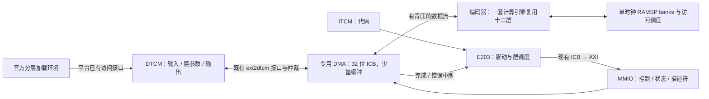

# KWT 编码器架构重整规划

日期：2026-10-31。状态：设计决策与迁移计划，尚未实现、尚未取得新架构的时序/PPA 结果。

实施更新：G0/G1 第一批控制器及协议测试已开始，见 [单端口存储改造](单端口存储改造.md)。
当前只有本地协议替身测试证据，真实宏绑定、小综合与整机迁移仍未完成。

## 1. 决策与边界

先建立可验证的存储与传输契约，再继续优化。保留已验证的数值算法、64 乘法器阵列、
单层引擎复用十二层的结构；重整 SRAM 访问、分层装载与 CPU 数据搬运。
现有工程保留为功能对照，旧半拍试验的 PASS 不作为新架构验收依据。

| 项目       | 本次决定                                                                        |
| ---------- | ------------------------------------------------------------------------------- |
| CPU 接入   | 继续用 System Bus/MMIO；本轮不增加 NICE 指令                                    |
| 共享存储   | 保留平台已有 ITCM 256 KiB、DTCM 256 KiB；不扩容，不新增 DDR/Flash 控制器        |
| 模型布局   | ITCM 用于代码；DTCM 按层装载，不再把整模型分摊到 ITCM/DTCM 常驻                 |
| 私有 SRAM  | 主方案改为指定 RAMSP 宏、150 MHz 同一上升沿；每个物理 bank 每周期至多一次访问   |
| 冲突处理   | 显式请求/响应、背压与读改写调度；允许等待，不维持未经证明的一读一写吞吐假设     |
| 半拍 RAMTP | 保留历史版本用于对照，退出主线；不以关碰撞检查或调小 uncertainty 的方式替代重整 |
| 数据搬运   | 先取得新存储架构的 CPU PIO 正确性基线，再接专用 DMA 搬运器                      |
| 交付优先级 | 功能/精度、150 MHz、完整约束、面积与可复现优先；DMA 与重叠预取不能阻塞合格基线  |

赛题依据：指南第 3 页规定 System Bus/NICE 二选一、512 KB 共享 SRAM、分层装载及
150 MHz；第 8 页要求 E203 调度与搬运；第 11–12 页规定装载起点、功耗统计和 2.25 mm²
新增面积预算。DMA 由 E203 配置和调度，是拟采用的搬运实现；接入既有外部端口的具体
平台接线仍须核对竞赛工程与集成规则，不能仅凭参考代码宣称已获正式平台验证。

## 2. 当前证据及其限度

- v10 参数握手、背压及十二层数值回归已通过服务器真实 RAMTP 模型。
- v11 MMIO 与总线功能主机完成 6336 字节逐位一致验证，不等于 CPU 整机验证。
- v12 本地 CPU 完整诊断通过，但使用本地模型/检查器兼容处理；服务器原检查器下的
  完整 CPU 任务仍待确认。当前数据由测试平台预装，正式分层加载环境尚未接通。
- v9 冻结试验的 100 ps 是 hold uncertainty，修复后剩余 hold slack 仅约 0.272 ps；
  原 1 ns hold 基线仍 FAIL。该结果属于旧核心顶层、TT、理想时钟，不能代表当前完整外设。
- 半拍理想间隔约 3.3335 ns，厂商模型碰撞窗口为 3 ns；占空比和相对时钟偏斜会消耗
  这约 333.5 ps 的名义间隔余量。单次理想时钟短测试不能证明所有实际条件下成立。

数值结果可继续作为回归依据；旧网表、周期、面积和时序不能与新架构拼接成最终成绩。

## 3. 目标系统与职责

职责固定如下：加载环境提供输入和每层参数；E203 提交地址/长度、确认层号、处理完成和错误；
DMA 搬运字节；计算核心完成全部规定数值计算；存储控制器决定何时能读写物理宏。
TB 只提供外部激励并核对结果，不代替 CPU 驱动、不代算编码器、不直接修改私有 SRAM。

中间十一层激活始终留在加速器内部。最小实现先顺序执行“装一层 → 算一层”；
不以增加一整套下一层私有参数存储作为前置条件。

## 4. 共享存储与完整任务

### 4.1 建议内存图

以下为待落实到 linker、镜像工具与加载器的目标地址，不代表当前 `layout.json` 已修改。
保留现有输入/输出地址，便于回归比较。

| 地址                   |         分配 | 用途                                                       |
| ---------------------- | -----------: | ---------------------------------------------------------- |
| 0x80000000–0x8003ffff | ITCM 256 KiB | 启动、驱动、代码及少量常量；不放大批模型系数               |
| 0x90000000–0x90007fff |  DTCM 32 KiB | 层参数槽 A，30256 字节有效载荷                             |
| 0x90008000–0x9000ffff |  DTCM 32 KiB | 层参数槽 B，先预留，首版可以只使用 A                       |
| 0x90010000–0x9002ffff | DTCM 128 KiB | 软件工作区、加载器元数据与描述符，细分由链接与协议共同生成 |
| 0x90030000–0x90031fff |   DTCM 8 KiB | 输入，6336 字节有效                                        |
| 0x90032000–0x90033fff |   DTCM 8 KiB | 输出，6336 字节有效                                        |
| 0x90034000–0x9003ffff |  DTCM 48 KiB | data/bss、栈、mailbox 与保留区；沿用原边界前须检查重叠     |

单层传输格式先保持 v10：7564 个 32 位字，低字优先组成 3782 条 64 位记录。
十二层参数共 363072 字节。不能混用早期 29720 字节紧凑格式的容量统计。
参数槽不要求 CPU 再复制到 scratch；PIO 与 DMA 均直接从已准备好的槽读取。

每个槽的逻辑状态：`FREE → FILLING → READY → READING → FREE`。
元数据包含任务代号、层号和有效字节数；状态发布与启动 DMA 之前有必要的内存屏障。
READY 后加载器不得改数据，READING 时 CPU 不得覆盖；由 E203 在搬运完成后释放。
若官方加载器不提供双槽控制，首版采用单槽应答，不假造加载器并发能力。

DTCM A/B 双槽只能隔离加载器填充和当前层搬运。
若要将下一层传输与当前层计算重叠，还须增加加速器内部独立的参数银行；该优化暂不进入首版。

### 4.2 一次任务的顺序

1. 清空上次任务的有效状态、描述符、队列和计数器；程序代码可以保留，模型/任务数据不得冒充缓存命中。
2. 在首个输入或参数装载事务开始时启动评测计时，加载经平台既有接口进入 DTCM。
3. E203 启动输入搬运，将 6336 字节送到内部输入缓冲；写入全部提交后才允许计算读取。
4. 层 n 的槽 READY 后，E203 校验层号/长度并启动参数搬运；参数、LN 常量和量化系数全部
   提交到内部存储，确认无待写事务后启动该层计算。
5. 当前层结束须同时满足计算流水排空、存储队列排空与结果提交。内部传递激活，继续下一层。
6. 第十二层完成后，DMA 将 6336 字节输出写回指定 DTCM，收到最后一个成功的写响应才发布 DONE。
7. 在全部结果写回结束时停止计时，检查共享存储结果；加载等待、CPU、仲裁、DMA 和计算时间均包含在内。

程序预装和模型/输入装载分开处理。旧“仿真前一次性预置全模型”的任务计数仅作诊断，不能作为正式吞吐。

## 5. 私有 SRAM：从隐含拍数改为明确协议

### 5.1 首选实现

采用交付包中的 RAMSP128X16、RAMSP1024X16、RAMSP4096X16，实际按可用库和面积择深度；
首先只验证 RAMSP1024X16，一个尺寸通过后再扩展其余尺寸。
所有存储与控制逻辑使用同一 150 MHz 上升沿，不制造反相写时钟，不加倍频时钟。
每个物理 bank 一拍只能读或写；独立 banks 可以并行。逻辑宽度继续用多个 16 位宏拼接。

这消除了原方案依赖两端口错相及跨端口碰撞间隔的前提，**不会自动消除普通 setup/hold 违例**。
新方案同样必须检查寄存器到 SRAM 地址/控制/数据、SRAM 输出到寄存器、脉宽及周期约束。
未核对 RAMSP 手册/Liberty/真实模型之前，不把“SP 同钟”写成已证明安全。

### 5.2 存储访问契约

- 请求：`req_valid/req_ready` 加读写类型、地址、写数据和局部写掩码；仅握手成功才接受一次操作。
- 响应：读数据有效与操作完成响应；阻塞时保持有效信息稳定，首版每个 bank 只保留少量有界未完成操作。
- 完成：写完成须表示宏写入已提交，不是“数据刚进 FIFO”；提供 `idle/drain_done` 给层边界与复位控制。
- 顺序：同一 bank 按接收顺序生效；读必须看到此前已完成的同址写。并行 bank 的宽字读在数据全部齐备后返回。
- 局部写：优先累积为完整 16 位字。必须读改写时执行“读旧字 → 合并 → 写回”，事务期间锁住相关 bank；
  不承诺局部写每拍都能接受，也不沿用旧 pending 流水的吞吐假设。
- 有效性：SRAM 无须为复位整片清零，但必须清空有效位/字节掩码；首次局部写不得依赖旧任务的未初始化位。
  计算只能消费当前任务已初始化的数据。真实模型 X 检查继续保留。

首批实现选择在复位/显式 clear 后顺序写零，避免逐字有效位寄存器；初始化期间不接收请求，
其运行时间计入任务开销。这是上述有效性要求的一种具体实现，不要求宏自带复位。

事务延迟由真实宏和控制流水决定，上层看响应，不再靠“默认一拍以后就是我要的数据”。
若后续某些只读阶段固定为一拍返回，必须把这个条件写进接口与断言，并证明没有冲突。

### 5.3 对现有核心的影响

这不是把 `RAMTP` 名字换成 `RAMSP` 的修改。当前 `kwt_packed_sram` 同时进行上一条写提交和下一条读，
依赖 1R1W；当前参数接收、输入写入、层输出也有无 ready 的端口，都要迁移。

| 存储            | 保留的数据组织                    | 迁移重点                                              |
| --------------- | --------------------------------- | ----------------------------------------------------- |
| 权重            | 256 位宽 banks，按输出组/输入段读 | 装载时组装完整物理字；计算与装载分阶段                |
| bias/multiplier | 64 位记录                         | 读响应与对应累加结果/通道号对齐                       |
| X 激活          | 128 位宽                          | 输入字节合并写；读请求受可用端口限制                  |
| 共享 K/V        | 128 位宽布局                      | 生成与读取分阶段；写流水排空后才能切换阶段            |
| 层间 xhold      | 16 位宽、8 KiB 现有分配           | 两字节合并，层结束等最后一次物理写完成                |
| 最终输出        | 16 位宽、8 KiB 现有分配           | 输出写入排空后再读回 DMA；DMA 写共享内存确认后才 DONE |

数据布局和分配容量先尽量保留，深度/宏数只在新综合后确定，不能预填旧 40/44 宏数量。
新核心接口必须向上传播 `input_ready`、`param_ready`、`out_ready` 与层完成排空状态。

MAC 与量化流水已发出的结果不能因前端停顿而丢弃。读请求携带 token/通道/段号，按有效响应推进；
不可停的算术或 LN 流水必须在发射前预留结果缓冲容量，已有有效结果继续排出。
禁止直接用一个全局 stall 冻住所有流水和存储响应，以免写队列无法排空而死锁。
输出缓冲深度按最长不可停输出突发和宏服务能力计算，不能凭经验随手放两项 FIFO。

复位/ABORT 时停止新发射，处理已接受的访存响应与不可撤销写入；旧任务写入可留下物理值，
但不得在新任务中被视为有效数据。新任务须待旧事务排空或由任务代号可靠隔离后才能启动。

## 6. DMA 与 CPU 的边界

### 6.1 最小 DMA

专用块搬运器，不开发通用多通道 DMA，也不改 CPU 指令集。CPU 仍经现有 AXI 从接口配置。
DMA 从现有 `ext2dtcm_icb_*` 端口访问共享内存，内部直接接有背压的数据流，不绕回 CPU 逐字 MMIO 写。
首版支持三种固定目标：输入装载、单层参数装载、最终输出写回。

- 32 位、自然对齐；一个未完成 ICB 请求，响应到达后再继续，先保证顺序与可定位性。
- 描述符含方向/目标、DTCM 地址、字节数、层号、任务代号；运行中不允许覆盖当前描述符。
- 校验地址完整范围和加法溢出，再转换为 TCM 本地地址；禁止简单截取低位导致越界回绕。
- 输入/输出长度为 6336 字节；每层参数为 30256 字节；64 位记录按低 32 位在先组装。
- ICB 请求获准、响应返回、内部数据被接收分别计数；收到响应不等于内部写完。
- 有界 FIFO、读写背压、错误停止、超时诊断、部分完成计数和复位排空均纳入设计。
- 普通运行完成/出错设置 sticky 状态；接入平台既有中断汇聚，验证屏蔽、清除和 CPU 唤醒。

E203 DTCM 控制器已经有 CPU LSU 与外部访问的仲裁；参考代码中 LSU 优先。
DMA 不会多造一个 SRAM 端口，持续 CPU 数据访问可能拖慢 DMA。
CPU 运行时不应忙循环逐字读状态；先支持低频状态检查，再验证中断/WFI。
DMA 和加速器必须由系统时钟驱动，不依赖可能因 CPU 等待而关闭的核心门控时钟。

接线在竞赛平台的隔离集成副本/包装层完成，记录与原版的 diff 和哈希。
原 CPU 数据通路、TCM 容量、既有总线和加载入口保持平台定义。
若加载器也占用同一外部请求入口，首版按层交接所有权；未经仲裁不能把两个请求源直接相连。

### 6.2 保留 PIO 的目的

在同一新存储架构下保留 PIO 模式，用来验证 DMA 的结果和量化收益。
同一任务只能由 PIO 或 DMA 中一个拥有输入/参数/输出通道；忙时切换模式应拒绝并报告。
PIO 直接使用 DTCM 层槽，允许内部背压；去掉冗余 scratch 复制，但保留必要的发布/完成屏障。
DMA 接口若迟迟无法合规接通，可交付新存储架构的 PIO 配置；不能退回未闭合半拍网表冒充完成。

## 7. 时序与综合的正式规则

1. 小存储验证和最终 SoC 使用同一时钟目标。确认平台高频域实际为 150 MHz、AON 为 32.768 kHz，
   不能延用 CPU 指令测试的加速低频源来宣称系统工作频率已验证。
2. 独立 SDC 明确时钟周期、转换时间、I/O min/max、负载和 setup/hold uncertainty。
   为预算写依据：PLL/平台已知条件、宏适用角、综合前互连/偏斜假设及其未覆盖部分。
   原 1 ns 和试验 100 ps 均不是官方要求，任何一个都不能不加说明直接成为最终答案。
3. 先清点交付库中匹配电压/温度/工艺角的标准单元与 RAMSP 组合，按可用快慢角检查 min/max。
   没有的库角明确列为证据缺口，不拿单 TT 结果代表全角；统一功耗评分条件另行冻结。
4. 保留宏 timing checks、notifier、X 检查及所有有效时序弧。确有复位或工作模式例外时逐条写功能依据；
   禁止用 blanket false path、multicycle、异步时钟分组、改库或关闭检查来隐藏违例。
5. 分别报告核心、完整加速器（含 DMA/MMIO/SRAM）及 SoC，检查真实宏数量、未解析单元、
   未约束路径、最大转换/负载、setup/hold 和宏 min-period/pulse-width。
6. 评分硬门槛为规定条件下无有效违例。扣除有依据的不确定性后，可把额外 setup 余量 0.2 ns
   作为内部优化目标，而非赛题要求或“达到就安全”的保证；hold 同样以正确 min 模型与预算为依据。
7. 每轮有时间上限、日志、阶段保存点和明确退出原因，不重复四小时全局修复。
   返回码成功、生成报告、功能 PASS、时序 PASS 四种状态分开记录。

赛题不要求布局布线/流片，不把完整 CTS 签核列为参赛前置条件；
但必须如实说明综合阶段时钟模型和互连估计的适用范围。

## 8. 分阶段验收：未过关不扩大依赖

| 阶段              | 交付与通过条件                                                                                                                    | 未通过时的处理                                                        |
| ----------------- | --------------------------------------------------------------------------------------------------------------------------------- | --------------------------------------------------------------------- |
| G0：基线与契约    | 保存当前数值参考、输入/参数格式、源文件哈希和回归状态；冻结内存图、访存及层边界协议                                               | 先消除接口歧义，不开始全面改核心                                      |
| G1：单端口证明    | RAMSP1024X16 的真实手册/模型/库核对；16 位适配器、局部写和小规模宽字 banks 在 150 MHz 开 timing checks 通过；真实库小综合约束完整 | 调整存储流水/调度；其他 RAMSP 尺寸仍须逐个补证据。不进入整机 DMA 开发 |
| G2：新核心        | 单层中间结果及十二层 6336 字节与原数值模型逐位一致；随机存储等待、读写冲突、尾写、复位及连续任务通过；核心时序检查通过            | 定位到 bank/阶段，禁止同时扩大阵列或改量化格式                        |
| G3：合格 PIO 整机 | 竞赛版 E203 执行 C；官方加载路径（或明确标注的等价协议联调）按层入 DTCM；PIO 完整写回，原 CPU 检查器保留；完整顶层综合通过        | 保留此配置作为可交付基线；加载器未实接不能标为正式环境已通过          |
| G4：DMA 整机      | 逐项错误/背压/复位/中断/访问争用测试；CPU 发起完整任务；结果与 G3 一致，记录 CPU 占用、搬运时间和新增面积                         | 保留 G3，修复 DMA；只有测得任务时间或能耗收益后才选 DMA 为最终配置    |
| G5：冻结交付      | 同一配置的 12 个性能任务与独立组件、600 样本数值评测准备、综合前后功能一致、时序/面积、活动标注覆盖、能耗和全流程复现             | 缺失项继续列 OPEN，不用不同版本最优值拼接成绩                         |

验证从 16 位宏 → 局部写/宽字 → 单层 → 十二层 → AXI 主机 → 真 CPU。
局部写覆盖同址连续写、同 row 不同地址、bank 边界、掩码组合与未初始化字节；
端到端覆盖随机背压、加载晚到、第二个任务、参数错层/长度错误、未对齐/越界及运行中复位。
综合前后检查包括实际映射网表与原模型的输出比较；短关键场景做相应 min/max SDF 检查，
如工具支持顺序等价可作为补充，不能以纯 RTL PASS 替代综合网表证据。

## 9. 面积、性能与回退原则

先沿用 80 KiB 核心数据分配及 8 KiB 输出分配作为容量上界参考；
RAMSP 映射效率、缓冲寄存器、DMA 和接口全部重新计入 2.25 mm²。
内部以含接口的新增面积不超过约 1.8 mm² 作为留量目标，属于规划目标而非现有测量值。
若超出，优先削减预取/FIFO或调整 bank 深度，不能遗漏 DMA/存储面积。

单端口冲突和读改写可能增加周期；不承诺换宏后维持 3159181 拍。
先取得满足时序的完整任务时间，再根据访问计数选择合并写、独立 bank 或少量流水优化。
DMA 最先解决 CPU 逐字服务，不保证整体吞吐成倍提升，更不保证与当前计算完全重叠。
只比较同一数值配置、同一计时边界的 PIO/DMA 任务耗时、CPU 指令/等待、面积与能耗。
计时包含 DTCM 外部装载，功耗包含 E203、互连、共享 SRAM、DMA 和加速器；共享平台面积单列。

保留可复现版本，不直接覆盖服务器旧运行目录。不在本次规划中自动提交或推送当前未提交工作。
通过 G1 才迁移核心，通过 G3 才把 DMA 收益作为下一轮目标。任一步退回最近已通过的新架构版本，
不把未闭合的历史半拍方案当作合格回退版本。

## 10. 至 11 月 10 日的目标窗口

以下为执行目标，不是完成保证。最大不确定性是 G1 宏资料/时序条件和 G2 核心访存迁移。

| 日期目标    | 里程碑                                                             |
| ----------- | ------------------------------------------------------------------ |
| 10/31–11/1 | G0/G1：内存图与协议、RAMSP 小验证和真实库综合；先决定基础是否成立  |
| 11/2–11/3  | G2：迁移核心访存与排空控制，完成单层/十二层数值与核心时序          |
| 11/4–11/5  | G3：新架构 CPU PIO 端到端、分层加载和正式计时；满足条件再做 G4 DMA |
| 11/6–11/7  | G4 收尾或冻结 G3；完整顶层 PPA、综合网表检查与活动功耗             |
| 11/8        | 冻结用于报告的配置和哈希，停止引入新性能功能                       |
| 11/9–11/10 | 从干净目录复现、补缺失评测、报告与答辩材料                         |

若 G1/G2 推迟，优先取消 DMA、双缓冲并发、扩大阵列等可选优化，给正确性与交付留时间。
不能用压缩时序验证、预装缓存不计时或降低 150 MHz 来兑现日期。

## 11. 紧接本规划的第一批工作

1. 固化已有对照记录；为新架构使用独立目录与明确版本，保留数值模型和参数格式。
2. 读取服务器 RAMSP1024X16 的手册、Verilog、Liberty/DB 及可用角清单，输出简明引脚/延迟/掩码/时钟契约。
3. 实现一个独立的 16 位同钟 SP 适配器及读改写控制，验证后扩成小宽字 bank。
4. 提供一次有上限的真实宏短回归与小综合包，终端只汇总功能、时序、约束覆盖和首个失败原因。

此时不改 CPU ISA、不写 NICE、不接 DMA、不全面替换核心。
第一份应取得的新证据是 **G1 单端口存储在目标条件下的验证结果**。

## 参考与现状入口

- [赛题指南文本](赛题指南_文本.txt)
- [当前系统架构与数据流](系统架构与数据流.md)
- [E203 编码器集成候选](E203编码器集成.md)
- [现有半拍保持时间试验](SRAM半拍保持时间试验.md)
- 现有代码：`rtl/kwt_mem16.v`、`rtl/kwt_foundry_sram16.v`、`rtl/kwt_encoder_layer_compact.v`、
  `rtl/kwt_encoder_12.v`、`rtl/kwt_encoder_axi_top.v`、`tools/prepare_e203_kwt.py`。
