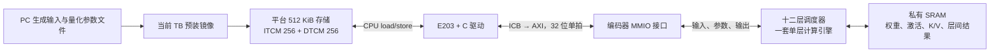

# 系统架构与数据流：当前实现和优化方向

2026-10-30。本文以当前代码为准，区分已实现结构、临时联调入口和优化建议。
集成入口是 `rtl/kwt_encoder_axi_top.v`；`kwt_axi_top.v` 是旧 MFCC 整机演示壳。

2026-10-31：后续设计选择见 [架构重整规划](架构重整规划_20261031.md)。
本文继续描述当前已实现结构；下文半拍 SRAM 与全模型 TCM 预装属于迁移前的基线。
新主线先验证同钟单端口 SRAM，再采用 DTCM 分层装载、MMIO 控制和可选专用 DMA。

## 1. 任务范围

硬件接收 int8 的 99×64 输入，完成全部十二层 Transformer 编码器，写回 99×64 输出。
音频规范化、MFCC、投影、class token 和位置编码在计算机端离线完成。
最后的分类头由统一软件评测程序执行，不属于本轮硬件任务。
因此当前硬件入口不是麦克风音频，也不是 MFCC 数据。

赛题允许 System Bus 或 NICE 选择一种接入。当前采用 System Bus；
NICE 尚未接入 KWT，DMA 也未实现。

## 2. 当前结构

平台共享存储与加速器私有 SRAM 是两类不同的存储。前者已有且可由 CPU 访问；
后者由加速器控制器直接产生地址并访问，保存当前层参数和计算中间结果。
这些私有 SRAM 是软件/硬件显式管理的缓冲，不是自动保持一致的 CPU cache。

AXI 接口目前是从设备：CPU 发起访问，加速器接收请求或返回数据。
加速器没有共享 SRAM 主设备接口，不能自主读取 ITCM/DTCM 中的指针。

## 3. 一次任务实际做什么

1. 仿真环境从文件预装程序、输入和模型到平台 TCM。v12 暂把前六层参数放 ITCM，
   后六层放 DTCM。这是联调布局，不是必须采用的最终分层加载方式。
2. CPU 复位任务状态，从 DTCM 取 6336 字节输入，以 1584 次整字 MMIO 写送入加速器。
3. CPU 写 START，编码器开始请求当前层参数。
4. 每层 CPU 回调将 30256 字节参数复制到约 30 KiB 的 scratch，随后逐字写参数端口。
   两个 32 位写拼成一条 64 位记录；核心未准备好时，握手和总线背压保留数据。
5. 当前层参数装入私有存储后，由硬件计算注意力、残差、LayerNorm 和 FFN。
   一套 64 乘法器 MAC 阵列顺序复用十二层，不是十二套独立引擎。
6. 上一层输出保存在内部层间缓冲，再送入下一层。中间十一层不会绕到 CPU 再写回。
   CPU 可以准备下一层 scratch，但当前没有完整的下一层私有参数预取缓冲。
7. 最后一层的 6336 字节进入输出 SRAM。CPU 轮询完成状态，执行 1584 次整字读取，
   将结果存回 DTCM；TB 检查 CPU 写回的内存是否与 golden 逐字节一致。

每层 7564 个 32 位参数字，十二层共 90768 字、363072 字节。
这包括 int4 权重、偏置、量化乘子、LayerNorm 参数和层常数，不是完整浮点模型。

关键地址：控制区 `0x40000000`，参数端口 `0x40000030`，输入窗口 `0x40001000`，
输出窗口 `0x40004000`。CPU 输入在 `0x90030000`，最终输出在 `0x90032000`。
逐项寄存器见 [MMIO 接口](MMIO接口.md)，TCM 布局见 [E203 编码器集成](E203编码器集成.md)。

## 4. 私有访存与计算

| 分配的 SRAM | 容量 | 用途 |
|---|---:|---|
| 当前层权重 | 32 KiB | Q/K/V/O 与两个 FFN 矩阵，按 MAC 需要的宽度分 bank |
| 偏置及量化乘子 | 8 KiB | 通道对应的数值处理参数 |
| 当前层输入 | 16 KiB | 输入激活及按行读取 |
| K/V 共享存储 | 16 KiB | 注意力跨 token 复用的数据 |
| 层间缓冲 | 8 KiB | 十二层之间传递激活 |
| MMIO 输出缓冲 | 8 KiB | 完成后供 CPU 顺序读回 |

核心分配 80 KiB，带 MMIO 输出缓冲预计 88 KiB、44 个 RAMTP1024X16；
新顶层实际映射数量和 PPA 仍需综合核对。以上是分配容量，存在对齐和深度余量。
少量行寄存器、累加器和 LN 参数寄存器另计，不包含在该 SRAM 容量中。

一次 MAC 发射处理 16 个输入和 4 个输出，共 64 次乘法；CPU 不参与这些乘加。
K/V 保留在 SRAM，score、概率和 FFN 中间向量尽量按行处理，不保存完整中间大矩阵。
目前 K/V 采用 128 位共享布局，部分计算向量要多拍组装，这是面积与吞吐的交换。

物理 SRAM 宏宽 16 位，通过多 bank 并联构成内部宽字。
读端用 root 上升沿，捕获后的写事务用 root 下降沿，避免原同沿宏碰撞问题。
参数与激活的格式和复用正确性已验证；最终 150 MHz 约束闭合仍未完成。

## 5. 数据来源和正式评测的差距

数值来源是指定预训练模型和 Speech Commands 样本，PC 离线脚本生成编码器输入、
定点参数及对照结果。`x.mem`、量化参数文件经打包器变成 TCM 镜像，
目前由 TB 直接预装存储阵列。TB 不代算十二层，也不替 CPU 写最终结果。

官方目标路径应为：加载仿真环境 → 平台已有访问接口 → 共享 SRAM → CPU 驱动/搬运
→ 加速器 → CPU 写回共享 SRAM。官方分层加载接口尚待接入。
不需要新建 DDR 或 Flash 控制器，赛题也明确不增设此类外部存储控制器。

当前计时覆盖共享存储已准备好之后的 CPU 输入/参数搬运、计算等待和输出写回，
不覆盖仿真前的文件预装。正式评测必须按官方“输入和参数开始装载”边界重做计时，
每任务清除数据/参数缓存状态；不能把当前预置模型版本直接称为正式吞吐或能耗成绩。
功能 TB 还沿用原指令测试环境中加速的低频时钟。正式系统活动功耗评估需按赛题
统一为高频 150 MHz、常开域 32.768 kHz，并核对 PLL/时钟模型和有效活动覆盖。

## 6. NICE 如何选择

NICE 是 E203 自定义指令及协处理器接口。平台示例暴露 rs1/rs2 请求、结果响应，
以及经 CPU LSU 路径的 ICB 访存请求/响应。示例模块尚未替换为 KWT。
它不是一块额外 SRAM，也不会自动赋予本设计 DMA 能力。

如果选择 NICE，值得比较的方案是 CPU 用自定义指令提交参数地址、长度或任务描述符，
硬件搬运控制器经 NICE 访存端口读取共享存储，并将记录送入现有参数握手接口。
指令每次控制一块数据，不应让每个 MAC 都由 CPU 发一条指令。
完成、错误、CPU 停顿、共享 LSU 仲裁及访存占用都需要按平台实现验证。
仅把 START/STATUS 改成自定义指令，保留逐字 CPU 搬运，不能解决主要搬运成本。

建议当前保留总线基线，不同时铺开 NICE 和独立 DMA 两条新路线。
先取得 CPU 分阶段周期，再判断块搬运的收益是否足以抵消接口、验证和面积成本。
若选择独立 DMA，必须先确认现有共享 SRAM 的可达主端口及仲裁接入方式；
目前不能假设在 AXI 从机加几个寄存器就能直接读平台 TCM。

## 7. 优化优先级

1. 对齐官方分层加载、任务缓存清空和计时边界，先得到可比较的 CPU 任务基线。
2. 减少软件搬运：当前参数先复制到 scratch 再写 MMIO；可增加直接从源缓冲取记录的路径。
   当前每个参数字先读状态，且读写两侧都有 fence，需在顺序语义验证后按批次减少这些开销。
3. 增加适量参数缓冲和批量接口，降低逐字轮询；长计算阶段可评估完成/参数请求中断。
   深 FIFO 与双缓冲是不同设计，真正跨层预取还需要独立的下一层存储空间。
4. 根据实测评估 NICE 块访存或总线块搬运器，以减少 CPU load/store/轮询指令。
5. 分解 SRAM 取数、K/V 组装、量化、非线性及状态机空拍，再优化内部吞吐。
   理想核心 MAC 有效利用率约 36%，应先定位空拍，不能仅靠增加乘法器数量判断收益。
6. 评估冗余激活拷贝、物理 SRAM 余量和空闲读使能的能耗，最后再考虑扩大阵列。

每项优化都应保持数值结果，并以同一配置的完整任务时间、面积和能耗评价。
当前总线主机回归已通过；本地 CPU 完整诊断也已完成，但采用上述本地检查器兼容处理，
服务器原始断言的 CPU 回归仍待确认。正式时序、完整集成 PPA、带活动功耗仍待完成。
